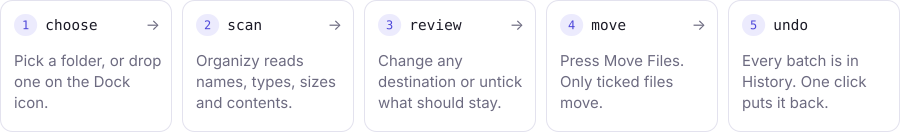

<picture>
  <source media="(prefers-color-scheme: dark)" srcset=".github/readme/out/hero-dark.svg">
  
</picture>

<p align="center">
  <a href="../../releases/latest"><b>Download for macOS</b></a>
  &nbsp;·&nbsp;
  <a href="https://seiunhim.github.io/organizy-app/">Website</a>
  &nbsp;·&nbsp;
  <a href="../../issues/new/choose">Report a bug</a>
  <br>
  <sub><code>free</code> · <code>macOS 14+</code> · <code>runs offline</code> · <code>MIT</code></sub>
</p>

---

### `how-it-works/`

<picture>
  <source media="(prefers-color-scheme: dark)" srcset=".github/readme/out/steps-dark.svg">
  
</picture>

### `features/`

```
review-first.list      nothing moves until you confirm
reads-inside.pdf       sorts by what files say: PDF, Office, text, OCR
undo.log               every move can be reversed
never-overwrite.rule   a taken name becomes "Report (2).pdf"
teach.rule             fix a destination once, it remembers
rules.json             type, name, keyword and size rules, live preview
local-ai.model         optional Llama 3.2 via Ollama, on your Mac
```

### `folders/`

By default, files go into folders inside `~/Documents/Organizy`. Content rules come first, so a PDF receipt lands in Invoices before it can fall into Documents.

```
~/Documents/Organizy/
├── Invoices & Receipts/   "amount due", "receipt", "factura"
├── Bank Statements/       "opening balance", "statement period"
├── Taxes/                 "W-2", "1099", "tax return"
├── Resumes & CVs/         "resume" in the name, "work experience"
├── Screenshots/           "Screenshot" in the name
├── Images/                jpg, png, heic, raw…
├── Videos/                mp4, mov, mkv…
├── Audio/                 mp3, wav, m4a…
├── Spreadsheets/          xlsx, csv, numbers…
├── Presentations/         pptx, key…
├── Documents/             everything else written
├── Archives/              zip, rar, 7z…
└── Installers/            dmg, pkg
```

### `install/`

1. Download `Organizy-x.y.z.zip` from [**Releases**](../../releases/latest), unzip it, and drag **Organizy** into **Applications**.
2. Open it. macOS blocks it the first time, because Organizy is free and isn't notarized by Apple ($99/year).
   - **macOS 15 and later:** click **Done**, open **System Settings → Privacy & Security**, scroll down and click **Open Anyway**.
   - **macOS 14:** right-click Organizy in Applications, choose **Open**, then **Open** again.
3. Optional: check the download. Each release lists a SHA-256, and this should print the same value:
   ```bash
   shasum -a 256 ~/Downloads/Organizy-*.zip
   ```

### `local-ai/` <sub>optional</sub>

Rules handle most files. For the ones they aren't sure about, Organizy can ask a small model that runs on your Mac.

```bash
# 1. install Ollama from https://ollama.com, then:
ollama pull llama3.2      # about 2 GB, once
# 2. in Organizy, turn on Local AI. A green dot means it's ready.
```

On a mixed test folder, rules alone sorted 15 of 21 files correctly, rules plus AI 20 of 21.

### `privacy/`

- No account, no analytics, no uploads. Organizy works offline.
- Local AI talks only to Ollama on your own Mac (`localhost:11434`). If you point it at another machine, Settings warns you.
- Organizy moves files and never deletes them. It only removes folders a move left empty, and Undo brings those back.
- Rules and history are plain JSON in `~/Library/Application Support/Organizy`.

### `feedback/`

[Open an issue](../../issues/new/choose) for bugs and ideas, or leave a review on the [website](https://seiunhim.github.io/organizy-app/#reviews). Please don't paste real file names or contents you'd rather keep private.

Security issue? See [SECURITY.md](SECURITY.md).

---

<sub>This repository holds Organizy's releases, website and issue tracker. MIT licensed, see [LICENSE](LICENSE). README images are generated by <a href=".github/readme/build.py"><code>.github/readme/build.py</code></a>.</sub>
