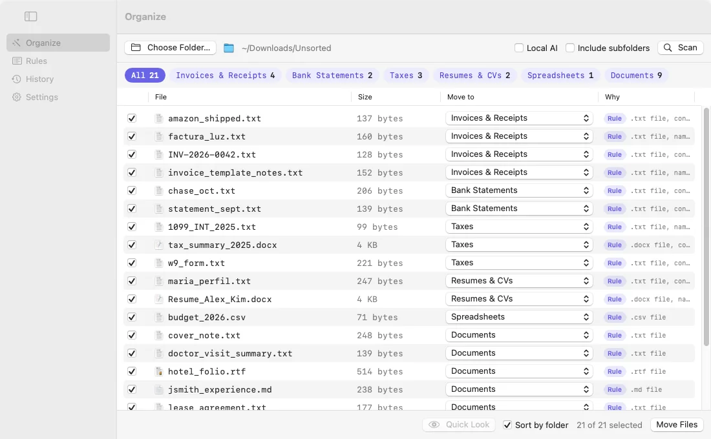

<picture>
  <source media="(prefers-color-scheme: dark)" srcset=".github/readme/out/hero-dark.svg">
  
</picture>

<p>
  <a href="../../releases/latest"><b>Download for macOS</b></a>
  &nbsp;·&nbsp;
  <a href="https://koschei-dev.github.io/organizy-app/#demo">Try the live demo</a>
  &nbsp;·&nbsp;
  <a href="https://koschei-dev.github.io/organizy-app/">Website</a>
  &nbsp;·&nbsp;
  <a href="../../issues/new/choose">Report a bug</a>
</p>

<br>

<a href="https://koschei-dev.github.io/organizy-app/#demo">
  <picture>
    <source media="(prefers-color-scheme: dark)" srcset=".github/readme/out/app-dark.svg">
    
  </picture>
</a>

<sub>The website runs the same rules on a sample folder in your browser. <a href="https://koschei-dev.github.io/organizy-app/#demo">Try it</a>.</sub>

<details>
<summary>A real screenshot of the app</summary>
<br>
<picture>
  <source media="(prefers-color-scheme: dark)" srcset=".github/readme/screens/organize-dark.webp">
  
</picture>
</details>

## How it works

**Choose a folder,** or drop one on the window or the Dock icon. Downloads and Desktop are the usual suspects.

**Organizy reads it.** Names, types and sizes first, then what's inside: PDFs, Office files, text, and words in images through on-device OCR.

**You review.** Every file gets a suggested folder and the reason for it. Change any destination, or untick what should stay.

**Only then does anything move.** And every batch is kept in History, so one click puts it all back.

## What it does

- **Asks before acting.** Nothing moves until you click Move Files.
- **Reads inside files,** so a PDF receipt lands in Invoices, not just Documents.
- **Never overwrites.** If a name is taken, the file becomes `Report (2).pdf`.
- **Learns from you.** Fix a destination once and Organizy offers to remember it.
- **Has rules you can edit,** by type, name, keyword and size, with a live preview.
- **It learns.** Point it at a folder you've already sorted, or approve a few moves, and similar files follow. Nothing is downloaded and it all stays on your Mac.

## Where files go

By default, into folders inside Documents › Organizy. Content rules come first, so a PDF receipt lands in Invoices before it can fall into Documents. You can change all of these in Rules.

| Folder | Catches |
| :-- | :-- |
| Invoices & Receipts | “amount due”, “receipt”, “factura” |
| Bank Statements | “opening balance”, “statement period” |
| Taxes | “W-2”, “1099”, “tax return” |
| Resumes & CVs | “resume” in the name, “work experience” |
| Screenshots | “Screenshot” in the name |
| Images, Videos, Audio | jpg, png, heic · mp4, mov · mp3, wav, m4a |
| Spreadsheets, Presentations | xlsx, csv, numbers · pptx, key |
| Documents | everything else written |
| Archives, Installers | zip, rar, 7z · dmg, pkg |

## Install

1. Download `Organizy-x.y.z.zip` from [Releases](../../releases/latest), unzip it, and drag Organizy into Applications.
2. Open it. macOS blocks it the first time, because Organizy is free and isn't notarized by Apple ($99 a year).
   - **macOS 15 and later:** click Done, open System Settings › Privacy & Security, scroll down and click Open Anyway.
   - **macOS 14:** right-click Organizy in Applications, choose Open, then Open again.
3. If you like, check the download. Each release lists a SHA-256, and this should print the same value:
   ```bash
   shasum -a 256 ~/Downloads/Organizy-*.zip
   ```

## Privacy

- No account, no analytics, no uploads. Organizy works offline.
- Organizy moves files and never deletes them. It only removes folders a move left empty, and Undo brings those back.
- Rules and history are plain JSON in `~/Library/Application Support/Organizy`.

## Feedback

[Open an issue](../../issues/new/choose) for bugs and ideas, or leave a review on the [website](https://koschei-dev.github.io/organizy-app/#reviews). Please don't paste real file names or contents you'd rather keep private. Found a security issue? See [SECURITY.md](SECURITY.md).

---

<sub>This repository holds Organizy's releases, website and issue tracker. Free and open source under the MIT license, see [LICENSE](LICENSE). README images are generated by <a href=".github/readme/build.py"><code>.github/readme/build.py</code></a>; fonts are Bodoni Moda, Jost and DM Mono (SIL OFL).</sub>
