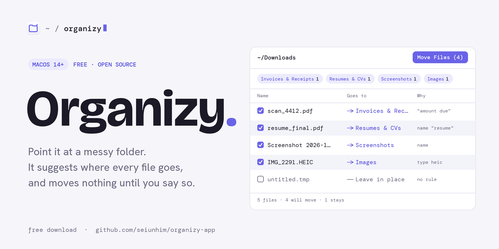

<picture>
  <source media="(prefers-color-scheme: dark)" srcset=".github/assets/banner-dark.png">
  
</picture>

<p align="center">
  <a href="../../releases/latest"><b>Download for macOS</b></a>
  &nbsp;·&nbsp;
  <a href="https://seiunhim.github.io/organizy-app/">Website</a>
  &nbsp;·&nbsp;
  <a href="../../issues/new/choose">Report a bug</a>
  <br>
  <sub><code>free</code> · <code>macOS 14+</code> · <code>runs offline</code> · <code>MIT</code></sub>
</p>

---

### `how-it-works/`

| | |
|---|---|
| `1  choose` | Pick a folder, or drag one onto the window or the Dock icon. |
| `2  scan` | Organizy reads each file's name, type, size and contents, and suggests a folder for it. |
| `3  review` | Check the list. Press Space to preview a file, change a destination, or untick what should stay put. |
| `4  move` | Press **Move Files**. Only the files you left ticked move. |
| `5  undo` | Every batch is kept in History. One click puts everything back. |

### `features/`

```
review-first.list     Nothing moves until you confirm.
reads-inside.pdf      Sorts by what files say: PDF, Word, Excel, PowerPoint, text, and text in images.
undo.log              Every move can be reversed.
never-overwrite.rule  Files are moved, never deleted or replaced. A taken name becomes "Report (2).pdf".
teach.rule            Change a destination and Organizy offers to remember that kind of file.
rules.json            Match by type, name, keywords or size, with a live preview of what each rule catches.
local-ai.model        Optional. Llama 3.2 through Ollama, on your Mac. Nothing goes to the cloud.
```

### `folders/`

By default, files go into folders inside `~/Documents/Organizy`. Content rules come first, so a PDF receipt lands in Invoices before it can fall into Documents.

```
~/Documents/Organizy/
├── Invoices & Receipts/   "amount due", "receipt", "factura"
├── Bank Statements/       "opening balance", "statement period"
├── Taxes/                 "W-2", "1099", "tax return"
├── Resumes & CVs/         "resume" in the name, "work experience"
├── Screenshots/           "Screenshot" in the name
├── Images/                jpg, png, heic, raw…
├── Videos/                mp4, mov, mkv…
├── Audio/                 mp3, wav, m4a…
├── Spreadsheets/          xlsx, csv, numbers…
├── Presentations/         pptx, key…
├── Documents/             everything else written
├── Archives/              zip, rar, 7z…
└── Installers/            dmg, pkg
```

### `install/`

1. Download `Organizy-x.y.z.zip` from [**Releases**](../../releases/latest), unzip it, and drag **Organizy** into **Applications**.
2. Open it. macOS blocks it the first time, because Organizy is free and isn't notarized by Apple ($99/year).
   - **macOS 15 and later:** click **Done**, open **System Settings → Privacy & Security**, scroll down and click **Open Anyway**.
   - **macOS 14:** right-click Organizy in Applications, choose **Open**, then **Open** again.
3. Optional: check the download. Each release lists a SHA-256, and this should print the same value:
   ```bash
   shasum -a 256 ~/Downloads/Organizy-*.zip
   ```

### `local-ai/` <sub>optional</sub>

Rules handle most files. For the ones they aren't sure about, Organizy can ask a small model that runs on your Mac.

```bash
# 1. install Ollama from https://ollama.com, then:
ollama pull llama3.2      # about 2 GB, once
# 2. in Organizy, turn on Local AI. A green dot means it's ready.
```

On a mixed test folder, rules alone sorted 15 of 21 files correctly, rules plus AI 20 of 21.

### `privacy/`

- No account, no analytics, no uploads. Organizy works offline.
- Local AI talks only to Ollama on your own Mac (`localhost:11434`). If you point it at another machine, Settings warns you.
- Organizy moves files and never deletes them. It only removes folders a move left empty, and Undo brings those back.
- Rules and history are plain JSON in `~/Library/Application Support/Organizy`.

### `feedback/`

[Open an issue](../../issues/new/choose) for bugs and ideas, or leave a review on the [website](https://seiunhim.github.io/organizy-app/#reviews). Please don't paste real file names or contents you'd rather keep private.

Security issue? See [SECURITY.md](SECURITY.md).

---

<sub>This repository holds Organizy's releases, website and issue tracker. MIT licensed, see [LICENSE](LICENSE).</sub>
